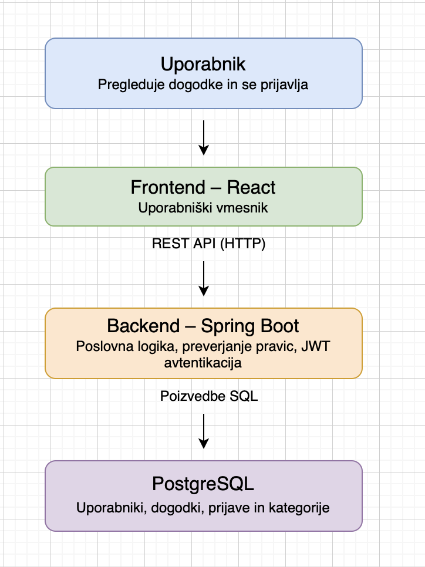

# Arhitektura in tehnološki sklad – EventFlow

## 1. Arhitektura

Aplikacija EventFlow bo sestavljena iz treh glavnih delov: frontenda, backenda in podatkovne baze.

- **Frontend:** predstavlja uporabniški vmesnik, prek katerega bodo uporabniki pregledovali dogodke, se nanje prijavljali in spremljali svoje prijave. Organizatorji bodo prek njega ustvarjali dogodke in pregledovali udeležence.
- **Backend:** obdeluje zahteve uporabnikov, preverja njihove pravice ter skrbi za ustvarjanje dogodkov, prijave, odpovedi in druge funkcionalnosti aplikacije.
- **Podatkovna baza:** shranjuje podatke o uporabnikih, dogodkih, kategorijah in prijavah.

Frontend in backend bosta komunicirala prek REST API-ja z uporabo HTTP-zahtev. Ko bo uporabnik na primer oddal prijavo na dogodek, bo frontend zahtevo poslal backendu. Backend bo preveril, ali je prijava mogoča, shranil podatke v podatkovno bazo in frontendu vrnil rezultat.

Za prijavo uporabnikov bo uporabljena avtentikacija z žetoni JWT. Dostop do funkcionalnosti bo omejen glede na uporabniško vlogo, na primer udeleženec, organizator ali administrator.

## 2. Tehnološki sklad

- **Frontend:** React, JavaScript, HTML in CSS.
- **Backend:** Java in Spring Boot.
- **Podatkovna baza:** PostgreSQL.
- **Avtentikacija in varnost:** JWT, Spring Security in BCrypt.
- **Lokalni razvoj:** Docker in Docker Compose.
- **Razvojna orodja:** Visual Studio Code ali IntelliJ IDEA, Git in GitHub.

## 3. Arhitekturni diagram



## 4. Arhitekturne odločitve

- **React:** Izbrala sem React, ker omogoča izdelavo preglednega in interaktivnega uporabniškega vmesnika ter ponovno uporabo komponent, na primer pri prikazu dogodkov in prijav.
- **Java in Spring Boot:** Izbrala sem ju, ker omogočata razvoj backenda, ki bo obdeloval prijave na dogodke, preverjal prosta mesta in skrbel za pravila aplikacije.
- **PostgreSQL:** Izbrala sem PostgreSQL, ker so uporabniki, dogodki in prijave med seboj povezani podatki, ki jih lahko relacijska podatkovna baza učinkovito organizira in ohranja njihove povezave.
- **REST API:** Izbrala sem REST API, ker omogoča izmenjavo podatkov med frontendom in backendom prek HTTP-zahtev.
- **JWT, Spring Security in BCrypt:** Izbrala sem jih za preverjanje identitete uporabnikov, omejevanje dostopa glede na njihove vloge in varno shranjevanje gesel.
- **Docker in Docker Compose:** Izbrala sem ju, ker omogočata zagon in povezovanje vseh delov aplikacije v ločenih vsebnikih z enotno konfiguracijo.


## 5. Lokalni zagon

Za lokalni zagon bo uporabljena datoteka `compose.yaml`, v kateri bodo definirani frontend, backend in podatkovna baza PostgreSQL. Docker Compose bo poskrbel za zagon posameznih vsebnikov in njihovo povezovanje.

Ko bodo pripravljene vse potrebne konfiguracijske datoteke, bo mogoče aplikacijo zagnati z enim ukazom:

```bash
docker compose up --build
```
