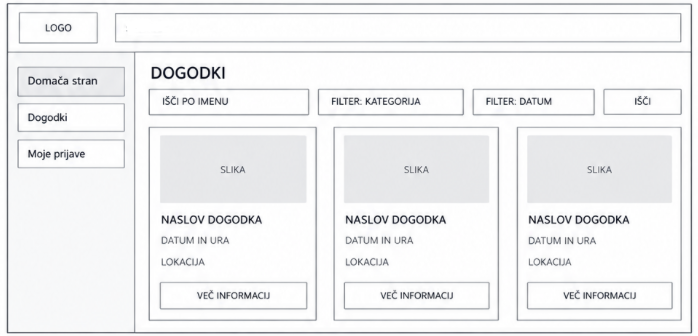
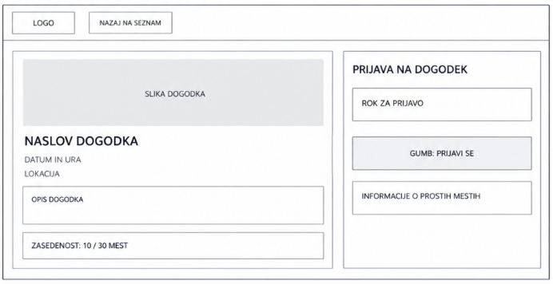
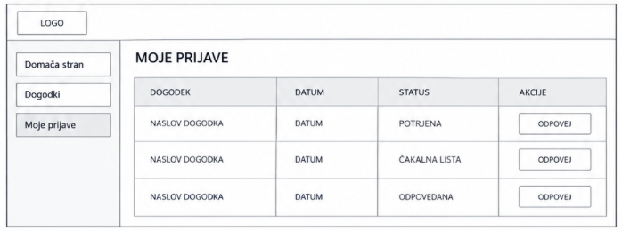

# Wireframe-i – EventFlow

## 1. Domača stran – pregled dogodkov

Prvi wireframe prikazuje domačo stran aplikacije EventFlow. Uporabnik lahko pregleduje objavljene dogodke, jih išče po imenu in filtrira po datumu ali kategoriji. Posamezen dogodek je prikazan v svojem okvirju z osnovnimi podatki in gumbom za ogled podrobnosti.

## 2. Podrobnosti dogodka in prijava

Drugi wireframe prikazuje podrobnosti izbranega dogodka. Prikazani so naslov, opis, datum, ura, lokacija, rok za prijavo in število zasedenih mest. Uporabnik se lahko prek gumba prijavi na dogodek, če izpolnjuje pogoje za prijavo.

## 3. Moje prijave – pregled prijav

Tretji wireframe prikazuje pregled prijav prijavljenega uporabnika. V tabeli so prikazani dogodki, datumi in statusi prijav. Uporabnik lahko spremlja, ali je njegova prijava potrjena, ali je na čakalni listi ali je bila odpovedana, ter odpove prijavo, kadar je to mogoče.